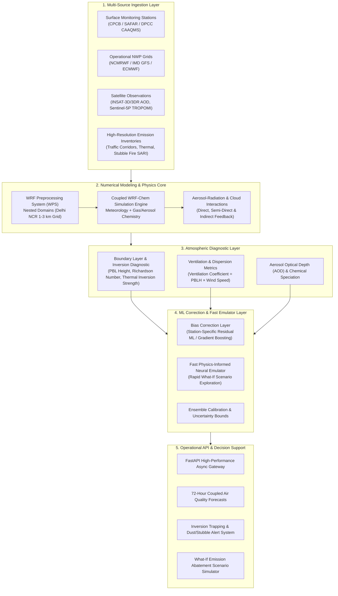

# Vayu AI Architecture & Technical Roadmap
**Problem Statement SIH26082:** Air Pollution–Weather Coupled Forecasting System for Delhi NCR  
**Phase 1 Status:** Foundation, Clean Contracts, & Runnable Verification

---

## 1. What Phase 1 Implements

Phase 1 provides an operational, runnable software foundation that establishes clear domain interfaces, data schemas, API contracts, and an interactive presentation shell without unnecessary external operational dependencies.

### Key Capabilities in Phase 1:
- **FastAPI Backend (`backend/app/`):**
  - `GET /api/health`: Provides operational health, versioning, and environment status.
  - `GET /api/stations`: Exposes curated representative Delhi NCR monitoring stations (e.g., Anand Vihar, Punjabi Bagh, Mandir Marg, IGI Airport T3, R.K. Puram, Sector 62 Noida) with coordinate metadata and atmospheric setting descriptions.
  - `GET /api/forecast?station_id=...`: Produces an exact 72-hour hourly forecast sequence with explicit physical units, UTC timestamps, query validation, and 404 handling.
- **Deterministic Synthetic Demo Engine (`backend/app/synthetic.py`):**
  - Generates deterministic, physics-inspired diurnal patterns for PM2.5, ambient temperature, surface wind speed, and Planetary Boundary Layer (PBL) height.
  - Utilizes a fixed reference timestamp (`2026-10-06T00:00:00Z`) and deterministic station-derived seeds, guaranteeing test reproducibility across environments.
- **Strict Response Schemas & Explicit Disclaimers (`backend/app/schemas.py`):**
  - Every forecast payload contains explicit top-level metadata: `data_mode: "synthetic_demo"`, `generated_at`, standard units (`µg/m³`, `°C`, `m/s`, `m`), and an unequivocal disclaimer stating that values are illustrative and unvalidated.
  - PM2.5 mass concentrations are explicitly labeled as concentrations in µg/m³ and never mislabeled as AQI.
- **Interactive React + TypeScript Frontend (`frontend/`):**
  - Station selector populated dynamically from the backend API.
  - Interactive SVG time-series chart showing the 72-hour PM2.5 trajectory with day delineations (+24h, +48h).
  - Synchronized hour inspection for selected lead steps (T+0h to T+71h) displaying coupled metrics: PM2.5, temperature, wind speed, and PBL inversion height.
  - Dual timezone presentation (UTC reference alongside Local Delhi IST, UTC+05:30).
  - Robust handling of loading, empty, and network error states.
- **Automated Verification Suite (`backend/tests/`):**
  - Automated tests validating health endpoints, station discovery, 72-hour sequence length, strict temporal continuity, determinism, physical boundary sanity, and error handling.

---

## 2. Intended Future End-to-End System Flow

The full Vayu AI platform will operate as an end-to-end, coupled air-quality and meteorological forecasting system tailored specifically to the complex basin topography and nocturnal inversion dynamics of Delhi NCR.

### Detailed Flow Stages:
1. **Ingestion Layer:** Aggregates real-time continuous ambient air quality monitoring stations (CAAQMS), gridded numerical weather forecasts from IMD/NCMRWF, satellite aerosol optical depth, and dynamic spatial emission inventories.
2. **Physics & Chemistry Core (WRF-Chem):** Runs multi-scale nested atmospheric simulation over the Indo-Gangetic Plain and Delhi NCR down to 1–3 km grid resolution, capturing the two-way interaction between aerosol particles and radiative heating/cooling.
3. **Atmospheric Diagnostics:** Derives critical boundary-layer stability indicators, nocturnal temperature inversions, ventilation factors, and aerosol optical depth columns.
4. **Machine Learning Layer:** Applies physics-informed machine learning to correct systematic numerical model biases against ground sensors and acts as a surrogate emulator for rapid emission control scenario analysis.
5. **Operational Delivery:** Serves calibrated 72-hour forecasts, automated GRAP (Graded Response Action Plan) advisories, and scenario simulation outputs to municipal stakeholders and the public.

---

## 3. Why Synthetic Demo Data Does Not Establish Forecasting Skill or Two-Way Coupling

Phase 1 explicitly relies on deterministic synthetic series. It is critical to recognize the fundamental distinction between demonstration data and scientific forecasting skill:

1. **Absence of Real-Time Initial Conditions:**  
   Skillful 72-hour atmospheric forecasting requires state-of-the-art assimilation of real-time initial atmospheric conditions (3D wind fields, surface pressure, vertical temperature soundings, background particulate concentrations). The Phase 1 demo series uses fixed mathematical harmonic equations.
2. **Absence of Coupled Navier-Stokes and Chemical Transport Physics:**  
   True air pollution–weather coupling involves solving stiff ordinary and partial differential equations representing turbulent boundary layer dynamics, chemical kinetics (e.g., MOZART or SAPRC mechanisms), gas-to-particle nucleation, wet/dry deposition, and radiative transfer feedbacks. Synthetic sine curves approximate diurnal rhythms for UI design, but contain no true conservation of mass, momentum, or thermodynamics.
3. **No Empirical Validation or Skill Metrics:**  
   Statistical validation requires calculating Root Mean Square Error (RMSE), Mean Fractional Bias (MFB), Index of Agreement (IOA), and Categorical Threat Scores against independent ground station observations over multiple seasons. The synthetic generator has not been fitted or validated against empirical CAAQMS observations.
4. **Absence of Stochastics and Dynamic Forcing:**  
   Atmospheric systems are chaotic; regional transport from agricultural stubble burning or dust storms creates sharp non-linear episodic spikes that cannot be predicted by idealized harmonic functions.

---

## 4. Future Integration Points (Planned Implementation)

Phase 1 has been architected with clean boundaries to facilitate future integration without requiring architectural rewrites:

| Subsystem | Phase 1 Foundation | Planned Future Integration |
| :--- | :--- | :--- |
| **Station Registry & Persistence** | Static in-memory dictionary of representative Delhi NCR stations (`backend/app/stations.py`) | **PostgreSQL (with PostGIS)** is the designated persistence layer for geospatial and temporal monitoring archives. (SQLite is explicitly prohibited to maintain production geospatial parity). |
| **Forecast Generation** | Deterministic generator (`backend/app/synthetic.py`) with fixed seeds | Pipeline service reading WRF-Chem NetCDF outputs, cached in Redis, corrected via an ML inference worker. Strict contract: never silently substitute synthetic data for failed live data requests. |
| **Contract Schemas** | Pydantic models (`backend/app/schemas.py`) | Extended schemas incorporating chemical speciation ($NO_2, SO_2, CO, O_3$), confidence intervals, and scenario deltas. |
| **API Architecture** | FastAPI modular routers (`backend/app/routers/`) | Background job queues (Celery/ARQ), asynchronous streaming, and cached spatial tile endpoints. |
| **Frontend Visualization** | React Leaflet map + SVG timeline + lead step scrubber | Multi-layer interactive maps (Leaflet/Deck.gl), aerosol-radiation feedback comparison charts, and scenario simulation controls. |

---

## 5. Phase 2 Map & Visualization Architecture

Phase 2 elevates the application shell into an interactive, spatial Delhi NCR exploration dashboard:

1. **Leaflet & React Leaflet Integration (`frontend/src/components/DelhiMap.tsx`):**
   - Utilizes `react-leaflet` (`MapContainer`, `TileLayer`, `CircleMarker`, `Tooltip`, `useMap`) integrated with React 18.
   - Plots discrete monitoring station coordinates directly from `GET /api/stations`.
   - Discrete station points only: does **not** fabricate spatial pollution plumes, interpolated grid heatmaps, or synthetic wind vectors.
2. **Basemap Usage Policy & Constraints:**
   - Employs public CartoDB Voyager tiles with required OpenStreetMap and CARTO attributions.
   - **No Bulk Prefetching:** Tiles are rendered on demand by browser HTTP requests adhering to standard tile usage policies. Bulk scraping or pre-downloading of tile sets is strictly prohibited.
   - **Visible Graceful Fallback:** If map tiles fail or cannot be reached (e.g. offline environments), a prominent banner notifies the user while keeping station markers and controls fully clickable and interactive.
3. **PM2.5 Concentration Color Legend (Not AQI):**
   - Marker color encoding represents raw PM2.5 mass concentration thresholds ($< 60$, $60\text{--}120$, $120\text{--}180$, $> 180\,\mu\text{g/m}^3$) and neutral slate for unavailable data.
   - The scale is strictly marked as a synthetic demonstration concentration scale and is never labeled as official CPCB Air Quality Index (AQI) categories.
4. **Session Forecast Caching & Single-Hour Synchronization:**
   - Station forecast sequences are retrieved once per session and stored in memory (`Record<string, ForecastResponse | null>`), eliminating redundant network traffic when scrubbing lead hours.
   - A single shared state index (`selectedHourIndex` from 0 to 71) synchronizes the summary metric cards, the Leaflet marker tooltips, the station details table, and the SVG timeline.
   - Final forecast step is explicitly labeled `T+71h` (never labeled "+3 days").
   - Strict data honesty: if a real sensor feed fails in subsequent integration phases, the error must be surfaced explicitly rather than masking it with synthetic outputs.

